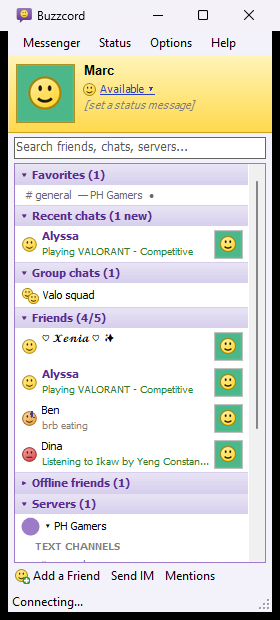
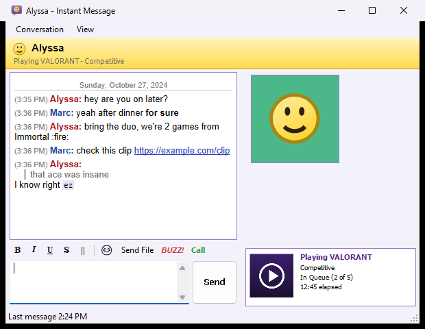

# Buzzcord

**A lightweight, old-school messenger for Discord.** Buddy list, IM windows, BUZZ!, smileys and the
yellow-and-purple look of the classic messengers, with plain Windows controls instead of a 400 MB
browser. Several accounts at once, rich presence on all of them, and voice calls.

<p align="center">
  
  
</p>

> [!WARNING]
> **Buzzcord is unofficial.** It isn't made, endorsed or supported by Discord Inc. Discord's Terms of
> Service don't allow third-party clients on user accounts. Buzzcord behaves like Discord's own web app
> and never automates anything, but Discord could still limit or ban accounts that use it.
> **Use it at your own risk.**

## Download

**[Download the latest release](https://github.com/mtits/Buzzcord/releases/latest)** or get it from
**[app.marcturtal.com/buzzcord](https://app.marcturtal.com/buzzcord/)**.

- Windows 10 or 11, 64-bit. Nothing to install: .NET Framework 4.8 is already part of Windows.
- The captcha window uses Microsoft Edge WebView2, which comes with Windows 11 (on Windows 10 it arrives with Microsoft Edge).
- **Buzzcord isn't code-signed yet** (it's a free hobby project, and certificates are expensive; free
  signing for open-source projects has been applied for). So Windows shows "Windows protected your PC" the
  first time: click **More info**, then **Run anyway**.
- If **Smart App Control** is on (Windows Security > App & browser control), Windows blocks unsigned apps
  completely, with no way to allow just one. Wait for a signed release, or build it from source.
- Each release lists the zip's SHA-256 checksum, so you can check your download is the real one.

## Getting started

1. Unzip it anywhere you like, for example `Documents\Buzzcord`, and run `Buzzcord.exe`.
2. Read the one-time notice, then sign in with the QR code: Discord on your phone > your profile
   picture > **Scan QR Code**. Add more accounts later from the tray icon's menu.
3. Buzzcord makes a Start menu and desktop shortcut, and lives in the notification area by the clock.
4. For rich presence, quit the official Discord app first, so games find Buzzcord instead.

This is the Windows version (`src/`, C# and WinForms). A macOS port is in `mac/` (see `mac/README.md`),
and `mac/PARITY.md` compares the two.

## Features

- Sign in by QR code (Discord phone app > profile picture > Scan QR Code) or by pasting a token. Several accounts at once, one buddy list window each. Tokens are stored encrypted with Windows DPAPI in `%APPDATA%\Buzzcord\accounts.dat`.
- Friends (online first, with what they're playing), friend requests (accept, ignore, cancel), recent DMs, group chats, servers and their text channels.
- Add a Friend by username (bottom toolbar, Ctrl+N, or from someone's profile). Search box over the list (Ctrl+F) filters friends, chats, servers and channels; Ctrl+F in a chat window searches its whole history with Discord's search.
- Profiles: right-click > View profile, or click a name or avatar. Opening one saves their full-size picture and banner to `Documents\Buzzcord Saved\<account>\Profile pictures`.
- An IM window per conversation: formatting buttons, smileys, server emoji, replies, edit (Up arrow), delete, typing indicator, BUZZ! (shakes the other person's window if they use Buzzcord too).
- Pictures, GIFs and videos (MP4) play inside the chat window. Send files with Send File, drag and drop, or paste (Ctrl+V): files copied in Explorer attach as files, and a picture keeps its format, so a GIF copied from a browser stays animated. Plain copied text still pastes as text.
- Attached files show above the message box with a thumbnail, name, size and an x, plus the total and this chat's limit (orange near the limit, red over it, progress while sending; Esc removes them all). Discord's limits are per file: 20 MB without Nitro, 50 MB with Nitro Basic or Nitro Classic, 1 GB with Nitro, and in a boosted server 50 MB (Level 2) or 100 MB (Level 3) for everyone. Up to 10 files per message. A file over the limit, an 11th file or a folder isn't attached, and Buzzcord says why; it never shrinks or splits a file to fit.
- Files sent in DMs and group chats are saved automatically to `Documents\Buzzcord Saved\<account>\<chat>` (Options menu to turn off or change the folder).
- Rich presence: Buzzcord listens on `\\.\pipe\discord-ipc-0` like the Discord app does, so games send their rich presence to Buzzcord, and it goes out on every signed-in account. It also shows "Playing X" for games it finds running, by comparing process names with Discord's public game list (no game process is ever opened). Quit the official Discord app so games find Buzzcord first; Help > Rich presence status shows what's happening.
- Friends' rich presence (game art, details, party size, elapsed time) appears under the buddy list and beside DM windows.

- Captchas: when Discord asks for one (adding friends, messaging someone new...), Buzzcord shows it in a small window and sends the request once it's solved. That window uses Edge WebView2 (built into Windows 11); Microsoft's WebView2 libraries are in `lib\` and get copied next to the exe.

- Themes: Options > Theme (Match Windows, the default; Light, the classic look; or Dark). Windows switches live, title bars included.
- Favorites: right-click any chat or server channel > Pin to Favorites. "Notify me about every message" follows a channel (a dot marks followed ones).
- Mentions & notifications (bottom toolbar or Ctrl+M): Discord's own mentions inbox, plus a saved history of every alert Buzzcord showed (messages, mentions, friend requests, sign-ins, followed channels). Both read like a chat, newest at the bottom; "Show older mentions" at the top loads more above. Clicking a tray notification opens its chat.
- Quiet rules: Busy (dnd) silences pop-ups, sounds and balloons. Quiet while gaming (on by default) means no pop-up windows or sounds while a detected game runs, just the tray balloon. Discord's own mute settings are respected.
- Group order: Favorites, Recent chats, Group chats, Friends, Offline friends, Servers, Friend requests by default; Options > Arrange groups to change it.
- Member sidebar: server channels show Discord's member list (role groups, online/offline, role colours, what people are playing); group chats list their members, online first. Click someone for their profile; View > Show members hides it.
- Unfriend alerts: when someone removes (or blocks) you, it's shown and kept in the notification history. Discord never says who blocked you, so a friend blocking you looks the same as them unfriending you.
- Blocking: Block... in the right-click menu of a friend, a Recent chat or a friend request, and on a profile (it asks first; blocking a friend also unfriends them, and they aren't told). Messenger > Blocked users lists everyone you've blocked, with Unblock (also on their profile). A blocked user's messages in servers and group chats are folded to "Blocked message" (click to show), a reply to one doesn't quote it, and they don't count as new or raise alerts.
- Remove from Recent: right-click a chat in Recent chats to close it, like the X in Discord's DM list. The messages stay, and it comes back with the next message. Not offered for a chat pinned to Favorites, or for group chats, where closing means leaving.
- Friend sign-in alerts with a door chime (Options to turn off). Unread count on the tray icon and a badge on the taskbar button.
- Reply from the alert: new messages pop up a small alert by the clock with a reply box, Reply, Mark as Read and Open (while a game runs it's the usual tray balloon instead, so nothing covers the game). In a server channel the reply answers that message; in DMs and groups it's a normal message. If a reply can't be sent, Buzzcord says why and shows what you typed.
- Unread Messages (Ctrl+Shift+U, or the tray menu): every unread chat on every account, with the messages themselves, Open, Mark as Read and Mark All as Read. It's the same list the tray and taskbar numbers add up. Message requests never count, and a DM nobody ever opened only counts while its last message is under 14 days old, so old untouched chats don't show as unread.
- Auto-Away: after 10 minutes without using the PC, or as soon as Windows locks, Available accounts show as Away ("Away (idle)" under your name) and switch back when you return. Busy and Invisible are left alone, and your chosen status isn't changed. While away, Discord sends notifications to your phone. Options > Auto-Away sets the time (Off, 5, 10, 15, 30 minutes) and the lock rule.
- Buddy list shortcut: Ctrl+Alt+B brings every buddy list to the front from any app. Options > Buddy list shortcut changes it or turns it off; if another app already uses the combination, Buzzcord says so.
- Message archive: DM and group chat text is appended to `Chat log.txt` beside the auto-saved files.
- Reactions: click a reaction to add or remove yours, or use "react" on a message for the smiley picker.
- Color emoji everywhere: in messages (emoji-only messages show big, like Discord), reactions and the smiley picker.
- Updates itself: it checks GitHub for a new release when it starts and every 6 hours, downloads it in the background, checks it against the release's SHA-256, and installs it when you restart (or the next time Buzzcord starts). Old files are cleaned up. Options > Update Buzzcord automatically; Help > Check for updates.
- Help > Donate (PayPal, GCash or bank transfer) and About.
- Voice calls (no video):
  - **Server voice channels** appear in the buddy list with the people in them. Double-click one to join; whoever's talking is outlined in green.
  - **DMs and group chats:** the Call button in the chat window rings them. Incoming calls pop up a ringing window with Answer and Ignore, and missed calls go into the notification history.
  - **The voice bar** at the bottom of the buddy list shows who's there, with Mute, Deafen and Leave. Right-click someone to change their volume.
  - **Options > Voice settings:** devices, voice activity (sensitivity with a live mic meter) or push-to-talk, mic volume, and "join muted". Push-to-talk only reads the key's state, with no keyboard hook.
  - **One call at a time** across all accounts.
  - **Encryption:** calls are end-to-end encrypted with Discord's DAVE protocol (MLS). The lock icon on the voice bar shows the voice privacy code, which matches the one in the official app. The code is in `src\Voice\`, checked against the MLS working group's test vectors in `testdata\mls`.
  - **Audio:** Opus comes from Concentus (`lib\Concentus.dll`, Opus license), loaded from memory.
  - **No echo cancellation yet**, so use headphones.

Not included: video calls and screen share, threads and forum channels, Nitro extras.

## Privacy and safety

- **No password, ever.** Buzzcord signs in with Discord's QR code. A token box exists for people who
  need it, but **never paste a token, script or "login code" someone sends you**: whoever has your token
  controls your account. That's the most common way Discord accounts get stolen.
- **Your sign-in stays on your PC.** Tokens are encrypted with Windows DPAPI for your Windows user, in
  `%APPDATA%\Buzzcord\accounts.dat`. They're never written to the log.
- **No telemetry, no ads.** Buzzcord only connects to Discord's own servers, to hCaptcha when Discord asks
  for a captcha, to the image addresses Discord sends (avatars, attachments, Spotify album art), and to
  GitHub to check for updates (it asks GitHub's public API for the latest release and sends nothing about
  you; Options > Update Buzzcord automatically turns it off). Links open in your browser only when you
  click them.
- **Game detection only reads process names**, the same way Discord does. It never opens, reads or
  injects into a game, so it's safe alongside anti-cheats like Vanguard.
- **Everything else stays local:** settings and the log are in `%APPDATA%\Buzzcord`, saved files and chat
  logs in `Documents\Buzzcord Saved` (both can be turned off in Options).
- **It's open source.** Every line is in this repository, so anyone can check what it does.
- **Only download it from here** (GitHub Releases) **or app.marcturtal.com.** Copies elsewhere could be
  tampered with. Found a security problem? See [SECURITY.md](SECURITY.md).

## Buy me a coffee

Buzzcord is free, with no ads and no tracking, and it'll stay that way. It's made by one person in
the Philippines, on evenings and weekends. If it brought a bit of the old messenger magic back to your
desktop, a small donation keeps it going and helps pay for a code-signing certificate, so Windows stops warning about it.

- **Anywhere:** [Donate with PayPal](https://paypal.me/abstinencelolph)
- **Philippines:** GCash or bank transfer (InstaPay): scan the QR code on
  [app.marcturtal.com/buzzcord](https://app.marcturtal.com/buzzcord/#donate) or in the app under **Help > Donate**.

Thank you!

## Build from source

```
powershell -ExecutionPolicy Bypass -File build.ps1 [-Test] [-Live] [-Ui] [-Sign] [-Package] [-Out <path>]
```

It builds with the C# compiler that's part of Windows (.NET Framework 4.8): no SDK or Visual Studio needed.

- `-Test` runs the offline self-test, and `-Live` adds checks against Discord that don't sign in (gateway handshake, QR login code).
- `-Ui` renders the windows with made-up data into `bin\ui\*.png`.
- `-Sign` code-signs the exe (see [SIGNING.md](SIGNING.md)), and `-Package` makes the release zip in `dist\`.

An unsigned build is blocked by Smart App Control, so `run.ps1` runs it inside PowerShell instead:

```
powershell -STA -WindowStyle Hidden -ExecutionPolicy Bypass -File run.ps1
```

The log is `%APPDATA%\Buzzcord\buzzcord.log`.

## License

Buzzcord is free and open source under the [MIT License](LICENSE). © 2026 Marc Turtal.
Bundled components keep their own licenses: see [THIRD-PARTY-NOTICES.md](THIRD-PARTY-NOTICES.md).
"Discord" is a trademark of Discord Inc. Buzzcord isn't affiliated with Discord or Yahoo.
